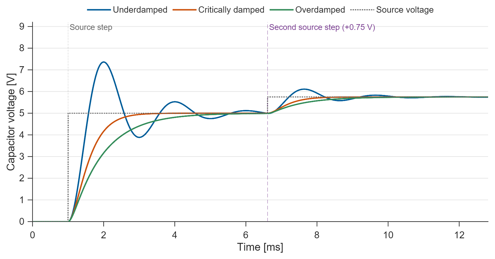
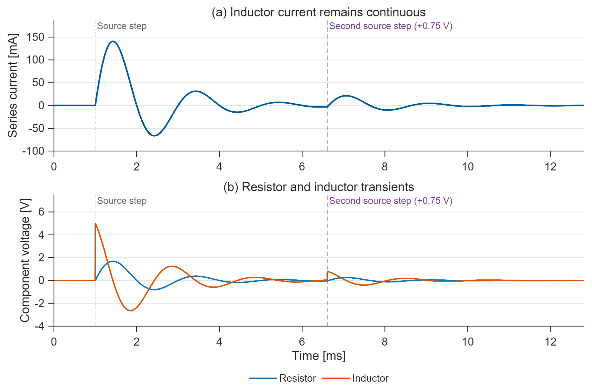
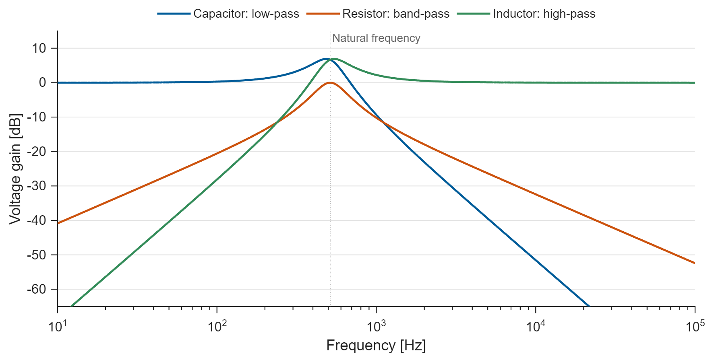

# RLC Circuit and Filter Lab

A series RLC circuit modeled with editable Simulink signal-flow blocks.
Compare damping, inspect component voltages/current, and obtain three filter
outputs from the same network.

## Run

Requires **MATLAB + Simulink**. Verified on **R2025b**.
Open this folder in MATLAB and run `run_demo`, or `run_demo(false)` without
figure windows. Edit `project_parameters.m` to change component values.

## Results

**Figure 1. Two source-input steps.** The source rises to 5 V at 1 ms.
After all three circuit cases have settled, it rises by another 0.75 V at
6.610 ms. This is a second source-input step, not a separately applied
disturbance. All cases settle at 5.75 V before the 12.812 ms endpoint.

**Figure 2. Electrical transients.** The nominal 12 ohm circuit carries a continuous
inductor current while resistor and inductor voltages ring after each source
change. Their sum with the capacitor voltage equals the instantaneous source.
The two source-step markers use the same times as Figure 1.

**Figure 3. Three filter outputs.** Capacitor, resistor, and inductor voltages give
low-pass, band-pass, and high-pass responses. The natural frequency is 513.67 Hz.
This is a frequency-domain calculation; the time-domain source events are shown
in Figures 1 and 2.

PNG previews, vector PDFs, CSV data and measured metrics are in `results/`.
The current release covers the continuous series-RLC lab; no digital-filter or
ADC anti-aliasing implementation is included.

Event times are derived rather than chosen: the slowest initial response settles
at 6.608 ms, so the second step is one 2-microsecond sample later. The final
response settles at 12.248 ms; 10% of its recovery duration is added as a short
tail. The criterion includes current and all component voltages.
`results/timing.json` records every case and the normalized 2% criteria.

## Equations and checks

$$L\dot i=V_{in}-Ri-V_C,\qquad C\dot V_C=i.$$

The three resistances give damping ratios 0.2324, 1.0 and 1.6. `run_demo` checks
the simulated capacitor voltage against a closed-form solution, Kirchhoff's
voltage law in both domains, and final settling. It requires no Control System
Toolbox. The model is an ideal lumped circuit without component tolerances.

Topic: **P02** in Muhammad Mudassir Shakeel's
[*MATLAB, Simulink & Simscape Project-Based Masterbook*](https://buymeacoffee.com/engrprogrammer).
Code, model and figures are independently developed; the book's code and paid
files are not redistributed. Original repository content: [MIT License](LICENSE).
